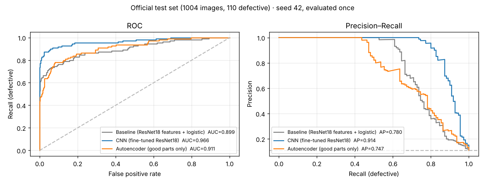
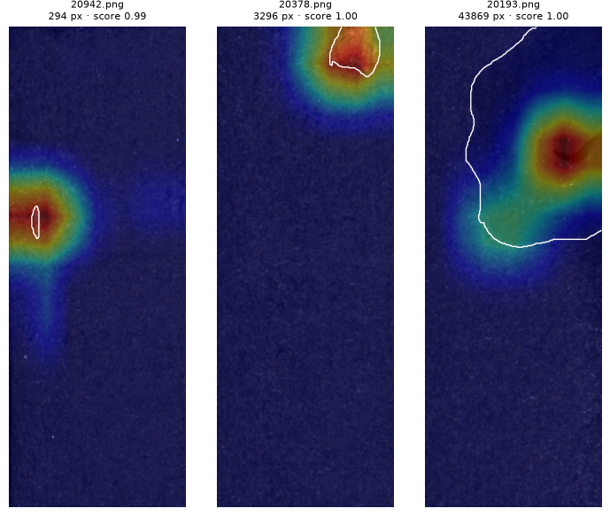

# InspectIA — automatic visual inspection of surface defects

Computer-vision system that looks at a photo of a manufactured part and decides whether its surface
is **OK** or **defective**, and shows **where** the defect is (Grad-CAM heat map). Built on
[KolektorSDD2](https://www.vicos.si/resources/kolektorsdd2/), real images from Kolektor Group's
production line. Final project for the Artificial Intelligence course (UCA, 2026).

**[▶ Try the live demo](https://huggingface.co/spaces/ipejinakis/inspetIA)**: the model runs in your
browser (ONNX Runtime Web), so no image leaves your device.

**Central question:** on this production line, is it better to use a model trained with examples of
defects (supervised CNN), or one that only knows what a good part looks like (autoencoder)?

## Results (official test set, evaluated once)

1004 images, 110 defective. Every threshold was fixed on validation before the test set was opened;
nothing was tuned on test.

| Model | Approach | F2 | Recall | Precision | AUC-ROC | AP |
|---|---|---|---|---|---|---|
| Baseline | Frozen ResNet18 features + logistic regression | 0.685 | 0.664 | 0.785 | 0.899 | 0.780 |
| **CNN** | ResNet18 fine-tuned (supervised), mean ± sd of 3 seeds | **0.834 ± 0.013** | 0.821 | 0.890 | **0.966** | **0.916** |
| Autoencoder | Convolutional AE trained on good parts only, mean ± sd of 3 seeds | 0.685 ± 0.051 | 0.712 | 0.607 | 0.909 | 0.744 |
| *Flag everything* | Trivial reference | 0.381 | 1.000 | 0.110 | — | — |



**Answer to the central question:** the supervised CNN wins clearly. Paired bootstrap on test
(seed 42): CNN − baseline ΔF2 = +0.138, 95 % CI [+0.082, +0.200]; CNN − autoencoder ΔF2 = +0.107,
95 % CI [+0.041, +0.179]. The autoencoder, which never saw a defect, ties the supervised baseline
(ΔF2 = +0.031, CI [−0.056, +0.117]), so it is a reasonable option when labelled defects are scarce.

**Where the CNN looks.** In 69 % of the detected defects, the peak of the Grad-CAM map falls inside
the annotated defect. The mask is used only for this check, never as model input.



<sub>Images: KolektorSDD2, © ViCoS Lab / Kolektor Group, CC BY-NC-SA 4.0. Overlay: Grad-CAM of our CNN.</sub>

**Recall by defect size (test, seed 42):**

| Defect size | Baseline | CNN | Autoencoder |
|---|---|---|---|
| < 250 px | 0/5 | 0/5 | 3/5 |
| 250–1000 px | 4/19 | 11/19 | 12/19 |
| 1000–3000 px | 26/36 | 31/36 | 28/36 |
| > 3000 px | 43/50 | 46/50 | 42/50 |

Small defects are the main weakness of the CNN (13 of its 22 false negatives are under 1000 px). There,
the autoencoder does better.

## Method

- **Metric:** F2 on the defective class, because a missed defect costs more than a false alarm. Recall,
  precision, AUC-ROC and average precision are also reported. Accuracy is never used as a main metric
  (89 % of the parts are good).
- **Protocol:** official KolektorSDD2 split. Validation is a stratified 20 % of the train split (seed
  42, 49 defective images). Hyperparameters, epoch and threshold are chosen on validation only. The
  threshold is the one that maximizes F2 on validation, fixed per model. The test set was scored once
  (locked by `results/TEST_EVALUADO.txt`).
- **Input:** images are vertical (~230 × 630 px), resized to 224 × 608 (width × height), keeping
  the vertical orientation. Grayscale is replicated to 3 channels with ImageNet normalization. Augmentation is applied
  to train only.
- **CNN:** ImageNet-pretrained ResNet18 with a 1-logit head, fine-tuned in two stages (head, then
  `layer4`), using BCE with `pos_weight` ≈ 8.5 and early stopping on validation AP.
- **Autoencoder:** a convolutional AE with a narrow bottleneck, trained with MSE on good parts only. The
  anomaly score is the top-1 % reconstruction error, since the mean error dilutes small defects.
- **Controls (validation):** class-balanced sampler vs `pos_weight` gave a tie (ΔF2 = 0.000).
  Pretrained vs small CNN from scratch was not conclusive in F2, but favours the pretrained model in AP,
  AUC and stability.

Full decision log in [`docs/DECISIONES.md`](docs/DECISIONES.md); every number with its source in
[`docs/RESULTADOS.md`](docs/RESULTADOS.md).

## Limitations

- **Validation → test gap:** CNN F2 drops from 0.923 (validation) to 0.834 (test), because model and
  threshold were selected on a validation set with only 49 defective images.
- **Unstable threshold:** the F2-optimal validation threshold of the CNN varies between 0.30 and 0.66
  across seeds. On test the F2 curve has a wide plateau (≈ 0.80–0.86), so the impact is moderate.
- **Autoencoder:** its best epoch is always epoch 1. It gets worse at spotting anomalies as it learns
  to reconstruct, defects included. Narrowing the bottleneck did not change this.
- **Small defects** (< 250 px) are missed by the CNN: ResNet18 downsamples 32×.

## Demo

Three verdicts, a design choice for a human-in-the-loop line:
- **DEFECTUOSA** (defective): probability ≥ validation threshold (0.663).
- **REVISAR** (send to a human): probability between 0.30 and the threshold.
- **OK**.

The Grad-CAM heat map is computed inside the exported ONNX graph.

- Public, static: <https://huggingface.co/spaces/ipejinakis/inspetIA> (`web/index.html`, `scripts/export_onnx.py`)
- Local Gradio app: `pip install gradio && python demo/app.py`

## Repository layout

```
configs/            one YAML per experiment (baseline, cnn, cnn_sampler, cnn_scratch, autoencoder*)
src/inspectia/      data, audit, features, models, train, evaluate, final, explain, demo
notebooks/          one per phase: 00_setup, 01_datos, 02_baseline, 03_cnn, 04_autoencoder, 05_evaluacion, 06_demo
splits/             train / val / test CSVs (versioned, so everyone uses the same split)
scripts/            download_data.py, export_onnx.py, build_space.py
demo/, web/         Gradio app and static Hugging Face Space
docs/               decisions log, results, status, study guides, planning docs
```

Trained checkpoints and result files (`checkpoints/`, `results/`) are not versioned; the team shares
them through a Google Drive folder.

## Reproduce

```bash
uv venv --python 3.11 && source .venv/bin/activate
uv pip install torch torchvision --index-url https://download.pytorch.org/whl/cpu   # or the CUDA build
uv pip install -r requirements.txt -e .
python scripts/download_data.py --dest data   # ~850 MB, from the official source
```

Then run the notebooks in order: `01_datos` → `02_baseline` → `03_cnn` → `04_autoencoder`
→ `05_evaluacion`. Each one starts with a common bootstrap cell. Training was done on Google Colab
(Tesla T4) and on an Apple-silicon Mac (MPS):

| Package | Colab version (checked 2026-11-14) |
|---|---|
| Python | 3.13.16 |
| torch | 2.14.1+cu130 |
| torchvision | 0.29.1+cu130 |
| CUDA / GPU | 13.0 / Tesla T4 |

Colab upgrades torch over time (it was 2.11.0 when the project started); the other packages are
pinned in `requirements.txt`.

<details>
<summary>Team setup (Colab + shared Drive)</summary>

1. Accept the GitHub collaborator invite and the W&B team invite.
2. Add the shared Drive folder `InspectIA/` to **My Drive** (right click → *Organize* → *Add shortcut*),
   so it is available at `/content/drive/MyDrive/InspectIA` in Colab.
3. In Colab, open **Secrets** (key icon) and add `WANDB_API_KEY` (from <https://wandb.ai/authorize>),
   with notebook access enabled.
4. Every session: open any phase notebook with a **GPU runtime** and run the bootstrap cell. It mounts
   Drive, clones or pulls the repo, installs dependencies and logs into W&B.

</details>

## Dataset, license and citation

KolektorSDD2 (ViCoS Lab, University of Ljubljana, with Kolektor Group), licensed
[CC BY-NC-SA 4.0](https://creativecommons.org/licenses/by-nc-sa/4.0/). The dataset is **not**
redistributed in this repository; `scripts/download_data.py` fetches it from the official source.

> Božič, J., Tabernik, D., & Skočaj, D. (2021). Mixed supervision for surface-defect detection:
> from weakly to fully supervised learning. *Computers in Industry*, 129, 103459.

## Team

Matías Fleman · Juan Ignacio Pejinakis Dip · Pablo Lamela · María Eugenia Quadro
